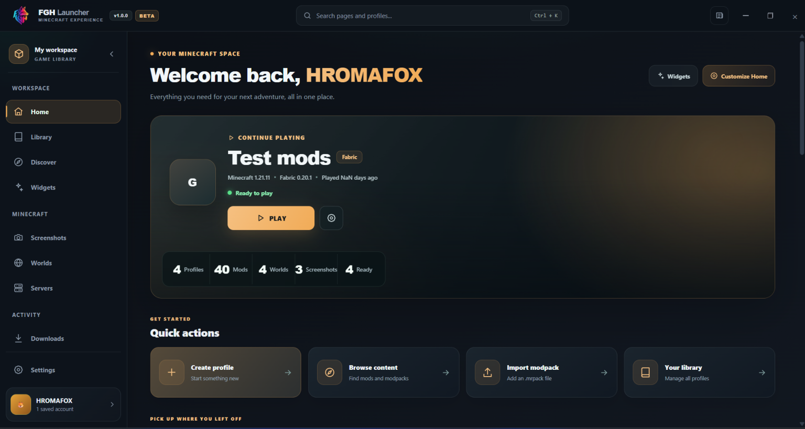
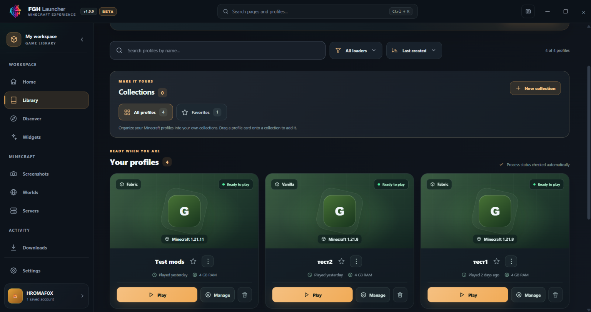
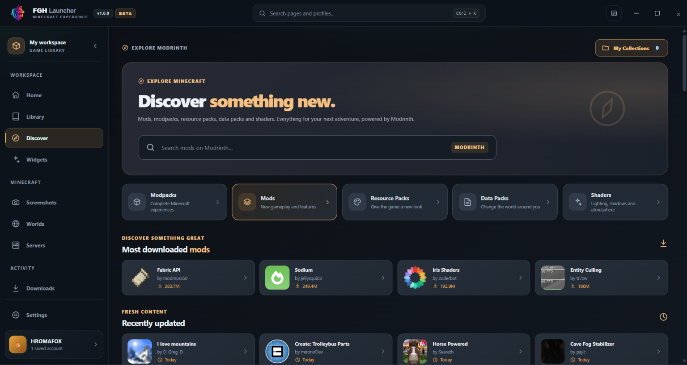

# FGH Launcher

**A modern, independent Minecraft: Java Edition launcher for Windows.**

FGH Launcher is a desktop application developed by **HROMAFOX / FGH Studio**, designed to make managing and playing Minecraft easier, more organized, and more customizable.

The launcher brings Minecraft installations, game profiles, mods, modpacks, and other management tools together in one application.

**Project Status:** Active Development  
**Platform:** Windows  
**Developer:** HROMAFOX / FGH Studio  
**Technology:** Rust, Tauri, Vue.js, TypeScript  
**Game:** Minecraft: Java Edition

---

## Launcher Preview

A first look at the FGH Launcher interface.

  

  <em>FGH Launcher — Home Dashboard</em>

---

## Features

### Minecraft Version Management

- Install and manage multiple Minecraft versions.
- Create separate installations for different versions.
- Support for Vanilla Minecraft.
- Support for Forge, Fabric, NeoForge, and Quilt.
- Configure Java runtimes, memory allocation, and launch settings.
- Repair and manage installed game files.

### Profile Management

- Create, edit, duplicate, and remove Minecraft profiles.
- Keep different game versions and mod configurations organized.
- Configure individual profile settings.
- Manage profile-specific game content.
- Track gameplay activity and playtime.

  

  <em>Minecraft Library & Profile Management</em>

### Mods and Modpacks

- Discover and install compatible mods.
- Browse projects available through Modrinth.
- Install and manage modpacks.
- Update installed mods and supported content.
- Manage resource packs and shaders.
- Organize and customize individual Minecraft installations.

  

  <em>Discover Mods, Modpacks & Minecraft Content</em>

### Additional Tools

- Minecraft world management.
- Screenshot management.
- Saved multiplayer server management.
- Download activity and progress tracking.
- Game logs and troubleshooting tools.
- Launcher settings and personalization.

Features are continuously being developed, tested, and improved.

---

## Account Management

FGH Launcher is designed to support both local identities and authenticated Microsoft accounts.

### Offline Accounts

The launcher supports local player identities for development, testing, and environments that permit offline-mode connections.

Offline accounts do not provide Minecraft ownership, valid Microsoft authentication, or access to servers requiring official account verification.

### Microsoft Accounts

Microsoft account integration is being developed to allow players who legitimately own Minecraft: Java Edition to authenticate using their existing Microsoft accounts.

The intended authentication process uses:

1. Microsoft OAuth 2.0 authentication.
2. Xbox Live authentication.
3. Xbox Security Token Service (XSTS).
4. Minecraft Services authentication.
5. Minecraft ownership and player profile verification.
6. Launching Minecraft with the authenticated player's identity.

Microsoft authentication takes place through Microsoft's sign-in services. FGH Launcher does not request users to enter their Microsoft passwords directly into the application.

**Current Status:** Microsoft account authentication is implemented for testing, but Minecraft Services access is pending application approval.

---

## Minecraft Services API Access

FGH Launcher requests permission to use Minecraft Services for legitimate Minecraft: Java Edition account authentication.

The requested access is intended to:

- Authenticate users through their Microsoft accounts.
- Verify that users have access to Minecraft: Java Edition.
- Retrieve official Minecraft usernames and UUIDs.
- Access the authenticated player's Minecraft profile.
- Launch Minecraft using valid authentication credentials.
- Support legitimate access to authenticated multiplayer services.

The application does not intend to bypass Minecraft ownership verification or Microsoft authentication requirements.

### Application Registration

FGH Launcher uses its own Microsoft Entra application registration.

The application is currently undergoing the Minecraft Services App ID approval process to enable legitimate Microsoft account authentication.

The existing authentication implementation reaches Minecraft Services but receives an `HTTP 403 – Invalid app registration` response while the application is not approved.

We are requesting authorization for our registered application to provide legitimate Microsoft account authentication to FGH Launcher users.

---

## Development Status

FGH Launcher is an ongoing independent software project.

The primary focus is to provide a reliable, customizable, and user-friendly Minecraft launcher with useful tools for players who manage multiple game versions, mods, and modpacks.

Additional improvements, performance optimizations, and new features are planned as development continues.

The Microsoft account authentication system is one of the features currently undergoing integration and testing.

Release information and additional screenshots may be added to this repository as the project progresses.

---

## Project Information

**Project Name:** FGH Launcher  
**Developer:** HROMAFOX  
**Studio:** FGH Studio  
**Application Type:** Desktop Minecraft Launcher  
**Supported Game:** Minecraft: Java Edition  
**Primary Platform:** Windows  
**Development Status:** In Development

This repository serves as a public information page for FGH Launcher, including information relevant to the Minecraft Services application approval process.

The source code is not currently published as part of this repository.

---

## Disclaimer

FGH Launcher is an independent third-party project.

It is not an official Minecraft product and is not affiliated with, endorsed by, or sponsored by Mojang Studios or Microsoft.

Minecraft and its associated names, trademarks, and assets belong to their respective owners.

FGH Launcher does not include a Minecraft license. Users are responsible for obtaining legitimate access to Minecraft: Java Edition.

The project aims to respect applicable Minecraft usage guidelines, account authentication requirements, and intellectual property rights.

---

**FGH Launcher — Developed by HROMAFOX / FGH Studio.**
