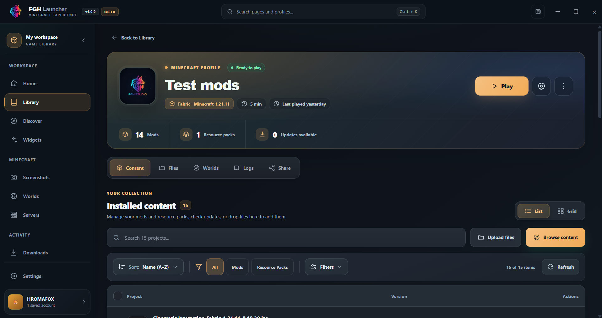
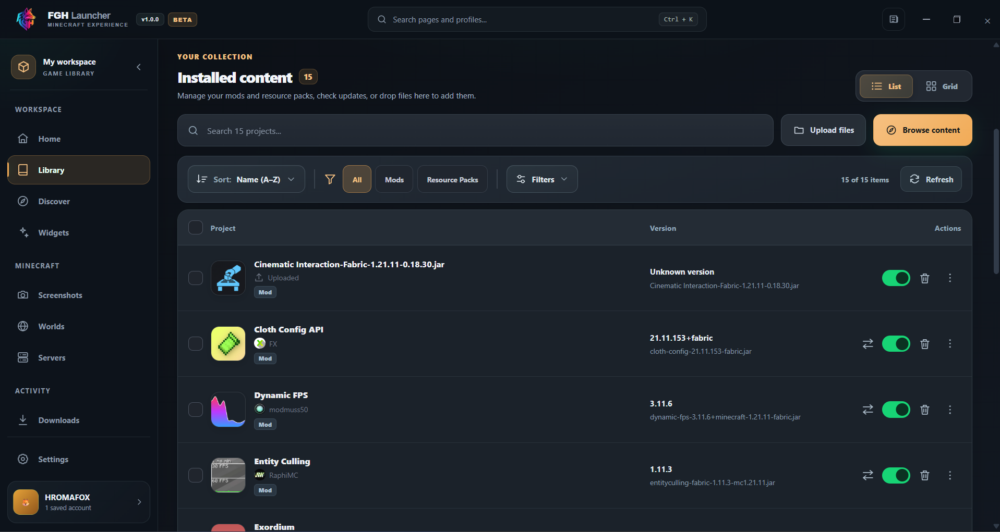
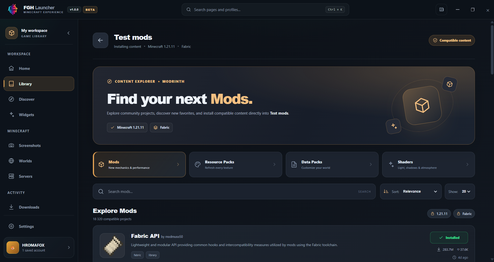
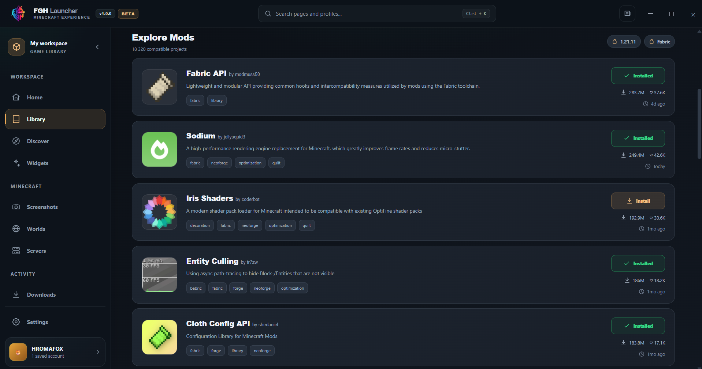
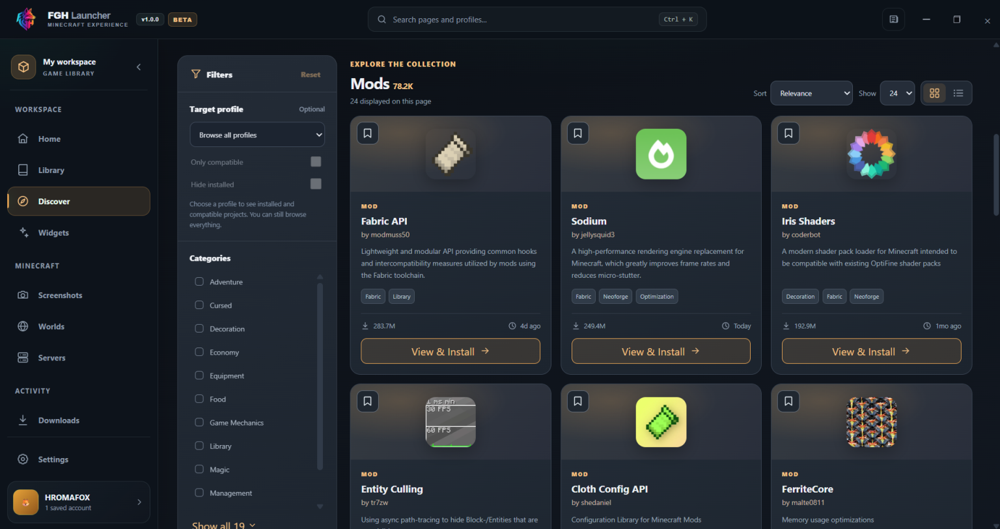

# FGH Launcher

**A modern, independent Minecraft: Java Edition launcher for Windows.**

FGH Launcher is a desktop application developed by **HROMAFOX / FGH Studio**, designed to make managing and playing Minecraft easier, more organized, and more customizable.

The launcher provides a modern interface for managing Minecraft installations, profiles, mods, modpacks, and other game-related content in one place.

FGH Launcher is currently under active development, with new features, improvements, and optimizations being introduced over time.

**Project Status:** Active Development  
**Platform:** Windows  
**Developer:** HROMAFOX / FGH Studio  
**Technology:** Rust, Tauri, Vue.js, TypeScript  
**Game:** Minecraft: Java Edition

---

## Launcher Preview

A first look at the FGH Launcher interface.

  

  <em>FGH Launcher — Home Dashboard</em>

---

## Features

### Minecraft Version Management

FGH Launcher provides tools for installing and managing different Minecraft versions and mod loaders.

Features include:

- Install and manage multiple Minecraft versions.
- Support for Vanilla Minecraft.
- Support for Fabric, Forge, NeoForge, and Quilt.
- Create separate installations for different versions.
- Configure Java and memory settings.
- Manage game files and repair installations when necessary.

### Profile Management

Create and organize Minecraft profiles with individual configurations.

Features include:

- Create, edit, duplicate, and delete profiles.
- Configure Minecraft versions and mod loaders independently.
- Manage profile-specific mods and settings.
- Organize profiles into collections.
- Mark frequently used profiles as favorites.
- Track gameplay activity and playtime.
- Quickly launch installed Minecraft profiles.

  

  <em>Minecraft Library & Profile Management</em>

  

  <em>Minecraft Profile Details & Management</em>

### Mods and Modpacks

FGH Launcher includes content discovery and management features to make customizing Minecraft easier.

Features include:

- Discover Minecraft mods and modpacks.
- Browse projects available through Modrinth.
- Search for content and filter results by category.
- Find content compatible with different Minecraft versions and mod loaders.
- Install and manage mods.
- Install and manage Minecraft modpacks.
- Check for available mod updates.
- Browse resource packs, data packs, and shaders.

  

  <em>Installed Mods & Resource Pack Management</em>

#### Direct Profile Installation

  

  <em>Discover Compatible Content for a Selected Minecraft Profile</em>

  

  <em>Install Mods Directly into a Minecraft Profile</em>

  

  <em>Discover Mods, Modpacks & Minecraft Content</em>

  

  <em>Browse Minecraft Mods, Apply Filters & View Installation Options</em>

### Additional Tools

FGH Launcher also provides tools for managing other aspects of the Minecraft experience.

These include:

- Minecraft world management.
- Screenshot management.
- Saved multiplayer server management.
- Download management.
- Game logs and troubleshooting tools.
- Launcher customization and settings.

---

## Account Management

FGH Launcher is designed to support both local player identities and authenticated Microsoft accounts.

### Offline Accounts

Offline accounts provide local player identities for development, testing, and environments that support offline-mode gameplay.

These accounts do not authenticate with Microsoft, do not verify Minecraft ownership, and are not equivalent to legitimate Microsoft-authenticated Minecraft accounts.

### Microsoft Accounts

FGH Launcher includes a Microsoft authentication integration for users who own Minecraft: Java Edition.

The authentication process is designed to use the official Microsoft and Minecraft authentication services.

The intended authentication flow includes:

1. Microsoft OAuth 2.0 authentication.
2. Xbox Live authentication.
3. Xbox Secure Token Service (XSTS) authorization.
4. Minecraft Services authentication.
5. Verification of Minecraft: Java Edition ownership.
6. Retrieval of the authenticated player's Minecraft profile.
7. Launching Minecraft with valid authentication credentials.

Microsoft authentication is performed through Microsoft's sign-in interface. The launcher does not require users to enter their Microsoft account passwords directly into the application.

**Current Status:** Microsoft account integration is undergoing testing. Minecraft Services access is pending application registration approval.

---

## Minecraft Services API Access

FGH Launcher requests Minecraft Services API access exclusively to provide legitimate Microsoft account authentication and Minecraft: Java Edition functionality.

The intended API usage includes:

- Authenticating users through their Microsoft accounts.
- Verifying Minecraft: Java Edition ownership.
- Retrieving official Minecraft player information.
- Obtaining the authenticated player's username and UUID.
- Supporting authenticated Minecraft launches.
- Enabling access to Minecraft services that require valid authentication.

FGH Launcher is not intended to bypass Minecraft ownership verification, distribute unauthorized copies of Minecraft, or circumvent Microsoft's or Mojang's authentication requirements.

### Application Registration

FGH Launcher uses its own Microsoft Entra application registration.

The application is currently undergoing the Minecraft Services App ID approval process.

During development and testing, Minecraft Services returned an HTTP 403 response indicating that the application registration was not yet authorized to access the required services.

Approval is being requested to enable the legitimate authentication functionality described above.

---

## Development Status

FGH Launcher is an actively developed project.

Development focuses on improving:

- Application performance and stability.
- Minecraft installation and version management.
- Profile organization and customization.
- Mod and modpack management.
- User experience and interface design.
- Microsoft account authentication.
- Compatibility with supported Minecraft versions and mod loaders.

Features may change as development progresses.

Additional project information, screenshots, and release details may be published as development continues.

---

## Project Information

| Information | Details |
|---|---|
| Project Name | FGH Launcher |
| Developer | HROMAFOX |
| Studio | FGH Studio |
| Application Type | Minecraft: Java Edition Desktop Launcher |
| Supported Platform | Windows |
| Development Status | Active Development |
| Technologies | Rust, Tauri, Vue.js, TypeScript |
| Microsoft Authentication | Integration in Testing |
| Minecraft Services Access | Pending App ID Approval |

This public GitHub repository provides information about FGH Launcher, its functionality, and its intended use.

It also serves as a public reference for the Minecraft Services application registration review process.

The application's source code is not currently published in this repository.

---

## Disclaimer

FGH Launcher is an independent third-party Minecraft launcher.

This project is **not affiliated with, endorsed by, or officially associated with Mojang Studios or Microsoft**.

Minecraft, Minecraft: Java Edition, Mojang Studios, Microsoft, Xbox, and their respective names, logos, and trademarks belong to their respective owners.

FGH Launcher does not include a Minecraft license or grant ownership of Minecraft.

Users are responsible for obtaining legitimate access to Minecraft and complying with the applicable terms of service, license agreements, and usage guidelines.

---

**FGH Launcher — Developed by HROMAFOX / FGH Studio.**
